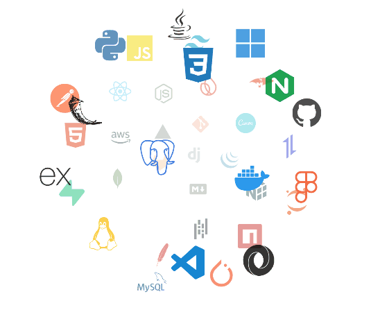

# Hi, I'm Abhi Khatiwada 👋

### Frontend Developer • UI Designer • Product-Focused Builder

I design and build fast, accessible, and polished web experiences from Nepal. My work
focuses on thoughtful layouts, clear visual hierarchy, responsive interactions, and
frontends that feel as good as they look.

<a href="https://abhi88.com.np"><strong>View my portfolio</strong></a> ·
<a href="mailto:khatiwadaabhi123@proton.me">Email</a> ·
<a href="https://github.com/aa-maker-dev">GitHub</a>

---

## What I am working on

- Designing a polished frontend for a **Doctor Patient Portal**.
- Building reusable components and responsive page layouts.
- Improving interaction design, accessibility, and frontend performance.

## Design and frontend focus

- **Visual design:** clean layouts, balanced spacing, contrast, and consistent type.
- **User experience:** intuitive flows, useful feedback, and accessible interactions.
- **Frontend craft:** responsive React interfaces with reusable, maintainable components.
- **Product thinking:** turning ideas into clear, practical experiences that solve real needs.

## Technical focus

| Area | Tools |
| --- | --- |
| UI and frontend | React, Next.js, TypeScript, Tailwind CSS |
| Design practice | Responsive layouts, component systems, accessibility, UX |
| Supporting skills | Node.js, REST APIs, authentication, databases |
| Workflow | Git, GitHub, prototyping, iterative delivery |

  <picture>
    <source media="(prefers-color-scheme: dark)" srcset="./Skills_Animation_Dark.gif">
    <source media="(prefers-color-scheme: light)" srcset="./Skills_Animation_White.gif">
    
  </picture>

## Current goals

- Grow my frontend and product design portfolio with strong case studies.
- Ship interfaces that are useful, accessible, and visually refined.
- Collaborate with designers and developers on meaningful web products.

## GitHub activity

  

  
View contribution animation

  

    <picture>
      <source media="(prefers-color-scheme: dark)" srcset="https://raw.githubusercontent.com/aa-maker-dev/AA-maker-dev/output/pacman-contribution-graph-dark.svg">
      <source media="(prefers-color-scheme: light)" srcset="https://raw.githubusercontent.com/aa-maker-dev/AA-maker-dev/output/pacman-contribution-graph.svg">
      
    </picture>
  

## Learning and credentials

  
  
  
  
  
  

---

## Let's connect

I am open to useful collaborations, product ideas, and conversations about frontend
engineering, automation, and building for the web.

  <a href="mailto:khatiwadaabhi123@proton.me">Email me</a> ·
  <a href="https://abhi88.com.np">Visit my portfolio</a> ·
  <a href="https://github.com/aa-maker-dev">Follow my work on GitHub</a>

